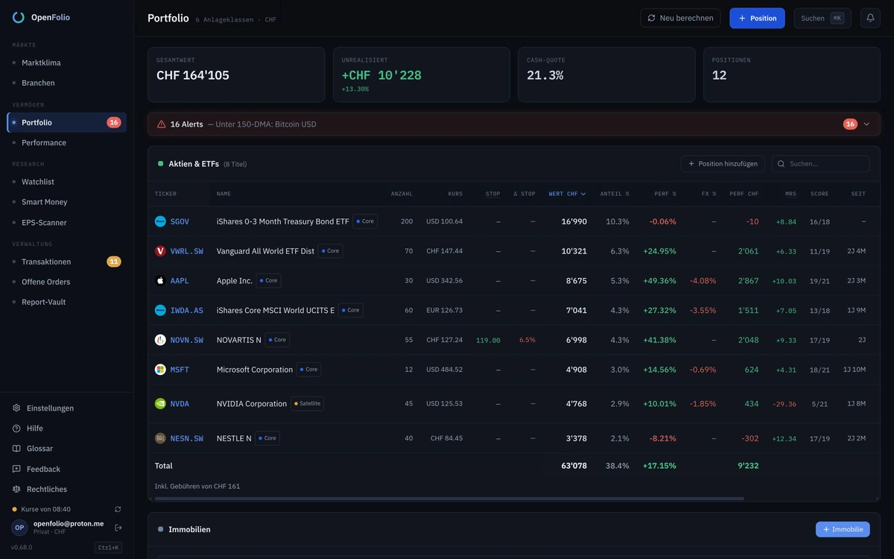
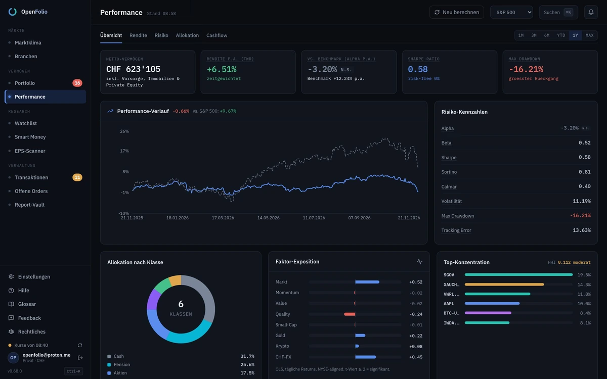
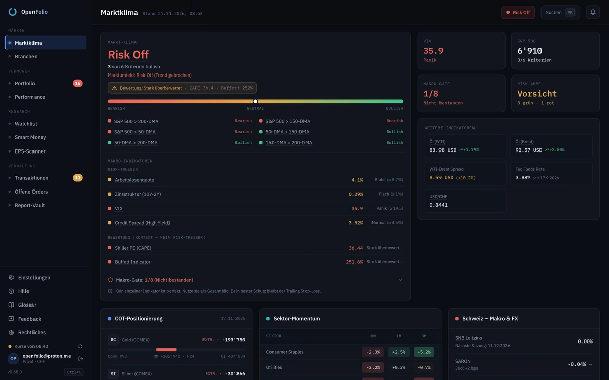
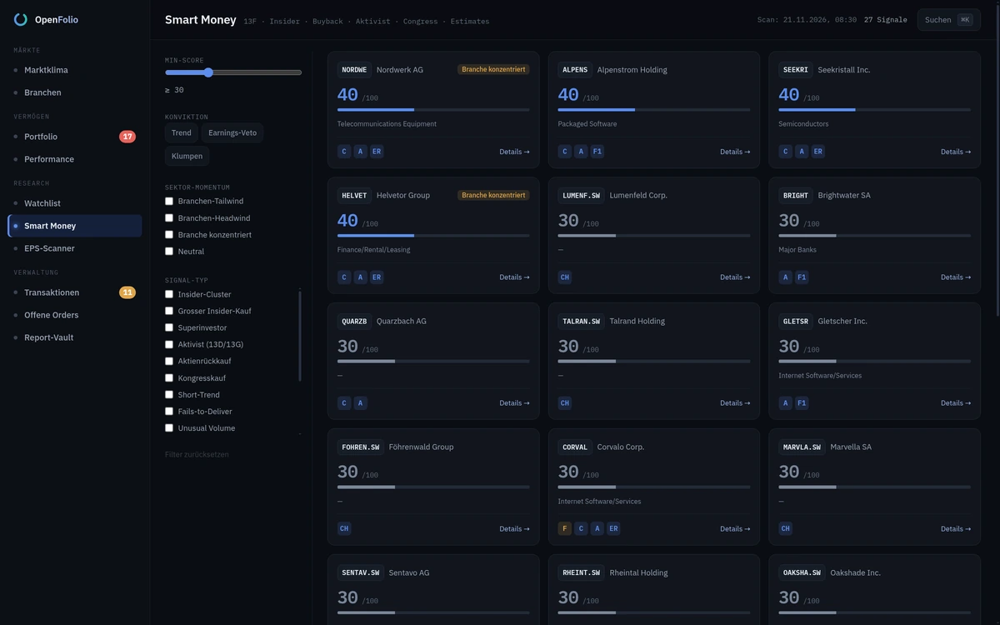

<div align="center">

# OpenFolio

**Self-hosted portfolio and net-worth manager with ETF look-through, built CHF-first.**

[Deutsch](README.md) · [Screenshots](#screenshots) · [Features](#features) · [Quick start](#quick-start) · [Security](#security) · [Status and limits](#status-and-limits)

`Open source` · `Self-hosted` · `Docker Compose` · `Multi-user` · `MIT`

</div>

---

## What it is

OpenFolio keeps your whole net worth in one place on your own server: stocks, ETFs, bond ETFs,
crypto, precious metals, cash, pension accounts, real estate with mortgages, and private equity.
It calculates returns in your base currency with the exchange rate of each trade date, looks
through ETFs down to the single holdings, and gives every view a REST API.

It started as a tool for one Swiss investor who had assets at several brokers, a pension
provider and a bank, and found no tracker that showed the full picture in CHF.

> **Read this first:** the user interface and the in-app help are in **German only**. There is no
> translation layer yet. The code, the API and this file are in English. If you want to help with
> an English UI, open an issue.

## Screenshots

Real screenshots from a test account.

| Portfolio | Performance |
|---|---|
|  |  |

| Market climate | Smart-money screening |
|---|---|
|  |  |

## Features

**Net worth in one data model**

- Stocks and ETFs, bond ETFs, crypto, physical precious metals, cash accounts, pension accounts,
  real estate with fixed and SARON mortgages, private equity
- Assets minus liabilities as one balance sheet, each position counted once
- Buckets (for example core and satellite) with target weight, benchmark and risk rules

**Return calculation you can check**

- Money-weighted return (XIRR), time-weighted return and Modified Dietz for monthly returns
- Foreign-currency trades booked at the rate of the trade date, with the currency effect shown
  per position
- Benchmarks converted to the base currency before the comparison
- The definitions are written down in [`docs/INVARIANTS.md`](docs/INVARIANTS.md) and pinned by a
  golden-master test suite, so a refactor cannot change a number without a failing test

**ETF look-through**

- Sector and country exposure through the ETF wrapper, down to single holdings
- Adapters for several UCITS issuers; concentration figures (HHI, effective number of positions)
  use the looked-through weights

**Import**

- CSV import with format detection for Swissquote, Interactive Brokers (Flex Query), Pocket and
  Relai, plus a generic CSV mapping
- Duplicate detection, import profiles, automatic dividend detection with withholding tax

**Risk and planning**

- Sharpe, Sortino, Calmar, volatility, drawdown, tracking error, information ratio
- OLS factor decomposition against eight factors, with t-values
- Rebalancing view with target, actual and delta per bucket and concrete trim candidates
- Stop-loss management with four methods, limit-order planning with fill reconciliation
- Dividend forecast and a FIRE projection in real terms

**Market analysis**

- Market-climate indicator from trend and macro checks (S&P 500 against moving averages, VIX,
  Shiller PE, Buffett indicator, yield curve)
- Swiss macro snapshot (SNB policy rate, SARON, CPI, 10-year yield, SMI)
- Rule-based setup checklist per stock, breakout detection (Donchian 20 days with volume filter)
- Smart-money screening from public sources: 13F filings, 13D/13G, insider transactions,
  congressional trades, buybacks, CFTC COT, SIX management transactions and others

**API**

- Versioned REST API under `/api/v1/external` with read and write scopes per API key
- Same service code as the web UI, so the numbers match
- Reference: [`docs/EXTERNAL_API.md`](docs/EXTERNAL_API.md)

**Alerts**

- Price, breakout, drift, concentration, stop-loss and dividend alerts by e-mail (your own SMTP)
  and ntfy push

## Quick start

Requirements: Docker with Compose v2, Git. On a VM, pass the host CPU through (`--cpu host` on
QEMU/KVM), because NumPy needs SSE4/AVX.

```bash
git clone https://github.com/dmxch/openfolio.git
cd openfolio
./init.sh
```

Then open <http://localhost:5173>. `init.sh` generates all secrets, creates the admin account
and starts the containers. All ports bind to `127.0.0.1`; to reach the instance from outside, put
a reverse proxy in front of it. The German [README](README.md#deployment-hinter-reverse-proxy) has
the proxy notes, and so does the
[installation article](https://openfolio.ch/hilfe/self-hosting/installation?ref=github).

Price data comes from free sources (yfinance, CoinGecko, FRED and others). Some optional features
need your own free API key, which you enter in the settings.

Update, backup and restore: see [Update / Backup / Restore](README.md#update--backup--restore).

## Stack

Python 3.14, FastAPI, SQLAlchemy 2 (asyncpg), Alembic, PostgreSQL 16, Redis 7, a separate
APScheduler worker, React 19, Vite, Tailwind CSS, Recharts. One `docker compose up` starts
database, cache, backend, worker and the nginx frontend.

## Security

- JWT access tokens with rotating refresh tokens and reuse detection
- TOTP two-factor login with backup codes, enforceable by an admin policy
- Field-level encryption (Fernet) for API keys, SMTP passwords, TOTP secrets, IBANs and notes
- Every query is scoped to the user; admins see account metadata, not portfolios
- Rate limiting, strict Content-Security-Policy, hardened containers (`cap_drop ALL`,
  `no-new-privileges`)
- Fonts are served locally, not from a font CDN

Report a vulnerability: see [`SECURITY.md`](SECURITY.md).

## Status and limits

- **German UI only.** See the note at the top.
- **No broker sync.** Positions come from CSV files or manual entry. No bank logins.
- **Free price data.** Quotes can be delayed or missing for some tickers.
- **Signals are analysis, not advice.** A built-in forward-return backtest shows that the current
  composite smart-money score did not predict returns in the data tested so far. The score helps
  you find activity; it is not a buy signal.
- **Swiss focus.** CHF is the default base currency (EUR and USD are selectable). Importers exist
  for brokers that Swiss investors use.
- **Tax reports** for Switzerland are on the roadmap and not built.

## Hosted version

The author runs a paid hosted version for customers in Switzerland and Liechtenstein at
[openfolio.ch](https://openfolio.ch/?ref=github). It uses this code plus private modules for billing. The
self-hosted version stays free under the MIT license with the full feature set described here.

## Contributing

Issues and pull requests are welcome. Please read [`CONTRIBUTING.md`](CONTRIBUTING.md) first.
Good first contributions: an English UI, new broker import profiles, more ETF issuers for the
look-through, tests and accessibility.

## License

[MIT](LICENSE)

---

> OpenFolio is an analysis tool and gives no investment or tax advice. All signals, scores and
> figures are rule-based calculations without warranty.
